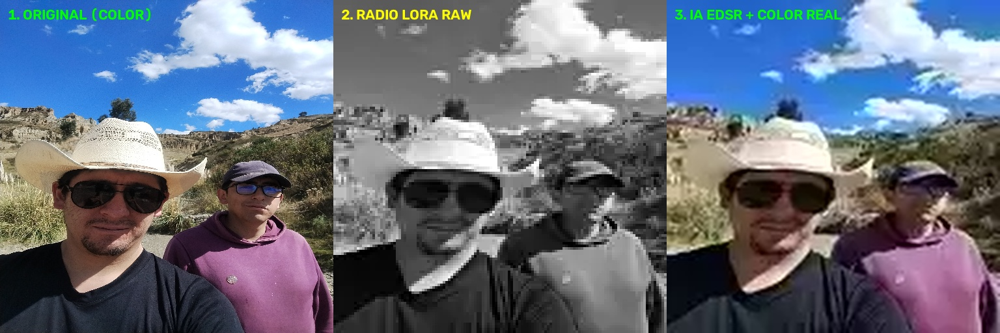

# LoRa-Vision-SR: Spectral Image Transmission & Super-Resolution over Radio Frequency

**LoRa-Vision-SR** is an extreme compression and deterministic visual reconstruction engine designed for critical ultra-low bandwidth communication links (**LoRa 433/915 MHz** radio frequency, satellite telemetry, and autonomous systems operating without cellular or Wi-Fi coverage).



## Technical Architecture

The system overcomes the physical bandwidth bottleneck of LPWAN networks (where each payload packet carries ~220 bytes) by splitting the image into the **YCbCr** color space prior to transmission:

1. **Fast Patrol Mode (Luminance `Y` Only - B/W):**
   * Extracts only the light intensity channel (`128x128 px`), applies micro-contrast sharpening (*Unsharp Mask*), and encodes into **WebP** (~1.8 - 2.2 KB, equivalent to **9–10 LoRa packets**).
2. **Spectral Reconnaissance Mode (`Y + Cr + Cb` - True Color):**
   * Transmits additional chrominance micro-packets (`32x32 px`, ~400 extra bytes) that preserve the true colors of the scene without relying on generative AI colorization.
3. **Deterministic Reconstruction at Base Station (`EDSR x4`):**
   * The receiving base station decodes the incoming packets and upscales the image to **`512x512 px`** using the **EDSR** (*Enhanced Deep Residual Networks*) deep neural network, recovering sharp edges without introducing visual hallucinations.

## Key Features
* **Zero Hallucinations:** Utilizes deterministic super-resolution networks (EDSR/FSRCNN) suitable for auditing, perimeter security, and robotics.
* **Progressive Transmission:** Allows operators to inspect the grayscale structure first and fuse true color on demand.
* **100% Royalty-Free:** Built exclusively on libraries and weights under permissive open-source licenses (**Apache 2.0 / BSD-3-Clause**).

## Installation & Quick Start

```bash
# 1. Install dependencies
pip install opencv-contrib-python numpy

# 2. Download deterministic EDSR x4 model weights
wget -O EDSR_x4.pb [https://github.com/Saafke/EDSR_Tensorflow/raw/master/models/EDSR_x4.pb](https://github.com/Saafke/EDSR_Tensorflow/raw/master/models/EDSR_x4.pb)

# 3. Run compression and reconstruction benchmark
python3 lora_vision_sr.py
```
